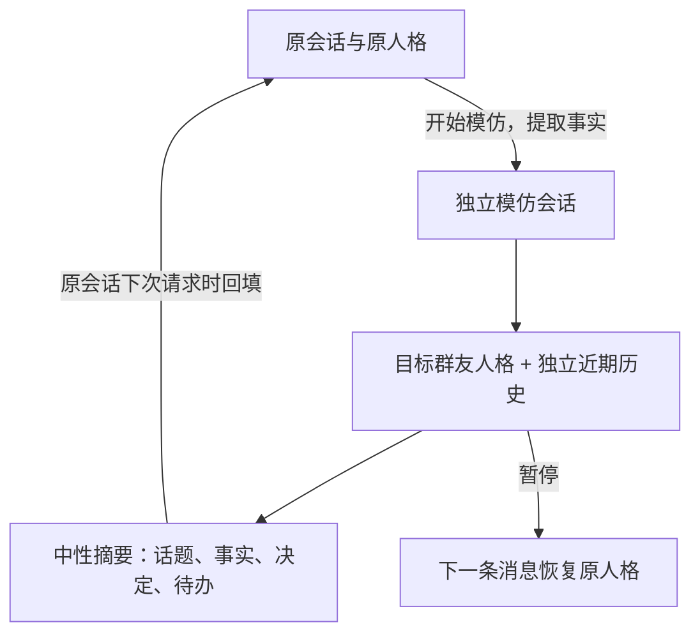

# MockSpeaker · 群友发言模仿

为指定群聊的群友建立发言风格人格。每个群友可以为 AI 选择不同的模仿对象，随时暂停并恢复原人格；模仿原文与原会话分开保存，通过事实摘要衔接聊天内容。

## 功能

- 按群白名单采集群内文字消息，按群、用户分别累计有效消息数。
- 支持通过管理员命令读取本群历史消息作为语料，可限定目标群友，重复导入自动去重。
- 达到下限自动生成群友人格；目标每新增指定条数的有效消息，自动更新人格。
- 可选跨群合并同一群友的消息计数和语料，综合生成共享人格，默认关闭。
- 每位发言者独立选择模仿对象，选择持久化，群聊和平台实例之间隔离。
- 模仿请求替换原人格和预设对话，使用独立的近期历史与事实记忆。
- 暂停或切换时提取剩余交流要点。恢复原人格后只回填中性摘要，保留话题连续性。
- 提供 AI 工具：列出可用群友、读取提示词、选择对象、暂停模仿。
- 可选同步到 AstrBot 人格库；支持查看提示词、手动更新和删除数据。

## 安装与配置

使用 **AstrBot 4.29.1 或更高的 4.x 版本**，配合内置本地 Agent 聊天流水线。插件本身只使用 Python 标准库，不需要额外运行时依赖。

将整个目录放到 AstrBot 的 `data/plugins/astrbot_plugin_mockspeaker/`，或在插件管理页上传安装 ZIP。加载插件后，在插件配置页设置：

```json
{
  "allowed_groups": ["123456789"],
  "cross_group_profiles": false,
  "min_messages": 100,
  "update_every": 50,
  "provider_id": "",
  "sync_personas": false
}
```

`allowed_groups` **默认空列表，表示全部关闭**。群号填字符串；多机器人实例可填写 `平台实例ID:群号`，例如 `qq_main:123456789`。平台实例ID是 AstrBot 消息平台配置的唯一 ID，不是适配器类型名。

`provider_id` 留空时，人格和摘要模型跟随消息所属会话的聊天模型；也可以指定已配置的模型提供商 ID。正常聊天仍使用 AstrBot 为该会话选择的聊天模型。

保存配置并重载插件后，开始采集后续消息；此前的群聊记录可使用下方的历史导入命令读取。将 `min_messages` 临时设为较小值，可先在测试群验证流程。

## 历史消息导入

AstrBot 管理员可在已启用的群中执行：

```text
/模仿 导入                  # 读取本群最近最多1000条消息
/模仿 导入 3000             # 读取本群最近最多3000条消息
/模仿 导入 3000 目标用户ID   # 只采集这些历史中目标群友的发言
/模仿 导入 3000 @目标群友   # 同上
```

条数范围为1–10000，指扫描的**群消息总数**，包含其他群友的消息和最终被过滤的内容，不是目标群友的有效发言数。导入会自动向前翻页，先提示正在读取，再报告读取数、新增有效语料数及人格任务数。同一群同时只允许一个导入操作；不同平台实例、不同群的记录分别保存。

导入命令自动选择来源：**OneBot 适配器（如 NapCat）**使用 `get_group_msg_history` 扩展接口读取群历史；**`qq_official` 等其他平台**读取 AstrBot 已保存的本地群历史。开始提示中会显示实际来源。

`qq_official` 没有可供此插件拉取任意群历史的接口。若要复用插件安装前的消息，需要当时已在 **AstrBot 主配置**中开启群历史保存，并且记录仍未清理，例如：

```json
{
  "provider_ltm_settings": {
    "group_message_history_enable": true,
    "group_message_history_max_cnt": 3000
  }
}
```

这是 AstrBot 的设置，不是插件配置。若此前没有开启，开启后才会开始保存，无法补回机器人从未收到、未保存或已清理的聊天记录。记录数量受 `group_message_history_max_cnt` 限制。QQ 官方机器人还需允许接收目标消息：若希望积累全群发言，在 QQ 群机器人设置中选择“获取群内全部消息”；Webhook 模式需订阅 `GROUP_MESSAGE_CREATE`。否则只能使用实际收到的消息。

QQ 官方平台的群和用户使用对应的 OpenID：`allowed_groups` 填该平台事件中的群ID（`group_openid`），目标用户使用 `/模仿 列表` 显示的用户ID，普通QQ群号和QQ号不能替代 OpenID。

导入沿用实时采集的排除用户、命令前缀、文字长度及消息组件过滤规则，只提取顶层文字，不读取图片、语音、转发或引用中的内容。新语料参与累计计数和跨群合并，达到首次生成或更新门槛后自动提交人格任务，无须等待目标再次发言；生成结果可用 `/模仿 状态 用户ID` 查看。语料窗口按原消息时间保留最近记录，补充更早的历史不会挤掉较新的发言。

OneBot 的历史范围由机器人账号和适配器实际可读取的记录决定，可能少于指定条数；插件不能取回适配器无法提供的历史。接口超时或后续分页失败时，已经读取的有效消息仍会导入，并在结果中说明；可重试命令。本地历史只读取当前平台实例、当前群保存的记录，跳过 AI 回复及图片、语音等占位文字。平台既没有 OneBot 历史接口、AstrBot 又没有本地历史读取能力时，会提示不支持。每次读取使用 `timeout` 超时设置。

消息ID独立保存，原文滚动清理后仍用于去重，重复导入不会重复计数。新采集的实时消息同时记录 AstrBot 提供的本地历史ID，防止与本地导入重复计数。升级前只能从尚保留的语料补齐平台消息ID，已清理的消息无法补齐；AstrBot 的本地记录不包含原平台消息ID，因此首次导入本地历史时，无法识别升级前已被插件采集的重叠消息。安装或重载插件不会自动拉取历史，需要管理员主动执行导入。

## 可选跨群合并

在配置页开启“跨群合并同一群友的语料”（`cross_group_profiles: true`）并重载插件后，会综合**同一平台实例、同一用户ID、当前 `allowed_groups` 中所有启用群**的消息来生成人格。默认关闭，关闭时各群分别生成人格。不同平台实例之间不合并。

例如下限100条，同一群友在 A 群有60条、B 群有40条有效消息，合计达到100条即可生成共同人格；更新间隔设为50时，后续两个群合计新增50条就会更新。分析时轮流读取各群最近的语料，共用 `analysis_chars` 字符预算；`max_samples` 仍按每群每用户保存。

开启后可使用已经采集并保留的语料，在该群友下一条有效消息到达时自动判断是否生成，也可由管理员执行 `/模仿 生成 用户ID`。首次合并人格生成前需等待生成完成；原有的各群人格保留，关闭开关并重载后恢复按群使用。修改群白名单后，按新的来源群集合查找人格，需要时重新生成，避免使用含已移除群语料的旧人格。

列表、工具和对象选择要求目标在当前群有采集记录。每位发言者的选择和模仿聊天记录仍按群独立；在 A 群选择或暂停模仿，不会更改 B 群的选择。跨群功能共享的是人格分析，不会合并聊天上下文。

## 群内命令

以下示例采用默认 `/` 唤醒前缀；若 AstrBot 修改过前缀，请相应调整。群聊本身的机器人唤醒、白名单和权限配置仍需正常启用。

| 命令 | 用途 |
| --- | --- |
| `/模仿` 或 `/模仿 帮助` | 查看帮助 |
| `/模仿 列表 [页码]` | 查看有效消息数和可用人格，每页20人 |
| `/模仿 开始 目标用户ID` | 为自己选择模仿对象，也支持 @目标群友 |
| `/模仿 暂停` | 暂停自己的模仿并恢复原人格 |
| `/模仿 状态` | 查看自己的选择 |
| `/模仿 状态 目标用户ID` | 查看采集、生成进度和失败状态 |
| `/模仿 提示词 目标用户ID` | 查看生成的人格提示词 |
| `/模仿 生成 目标用户ID` | 手动生成或更新，需 AstrBot 管理员权限，仍须达到下限 |
| `/模仿 导入 [条数] [目标用户ID]` | 导入本群历史语料，默认扫描1000条，可用 @限定群友，需 AstrBot 管理员权限 |
| `/模仿 删除` | 删除自己在本群的采集和相关隔离记录 |
| `/模仿 删除 目标用户ID` | 删除指定用户数据，需 AstrBot 管理员权限 |

英文等价命令为 `/mockspeaker help|list|start|stop|status|prompt|generate|import|forget`。

例如，甲执行 `/模仿 开始 乙的ID`，丙执行 `/模仿 开始 丁的ID`，则 AI 回复甲时模仿乙，回复丙时模仿丁。其他群友按各自选择工作。未开启模仿的群友使用原人格。

开始和暂停从**下一条触发 AI 的消息**生效；已经在生成中的回复会完成，并按原来的隔离会话归档。插件不会让机器人自动回复每条群消息，仍遵循 AstrBot 的 @、唤醒词和聊天触发规则。

## AI 工具

在 AstrBot 中启用相应插件工具，并使用支持工具调用的聊天模型：

| 工具 | 参数 | 行为 |
| --- | --- | --- |
| `mockspeaker_list` | 无 | 列出当前群达到门槛且已生成人格的用户 |
| `mockspeaker_get_prompt` | `target_id: string` | 读取当前群目标的人格提示词，不改变持久选择 |
| `mockspeaker_select` | `target_id: string` | 为当前消息发言者设置持续模仿对象，下一条消息起生效 |
| `mockspeaker_pause` | 无 | 暂停当前发言者的模仿，下一条消息恢复原人格 |

可向 AI 说“列出能模仿的群友”“之后模仿用户123456”“停止模仿”。工具描述要求只有用户明确提出时才改变选择。工具无法传入其他发言者 ID 来修改他人的选择。

读取提示词属于查询；若希望后续对话完整替换人格，应选择 `mockspeaker_select`。读取、选择、暂停工具的这一轮也会隔离保存，防止人格规则及持续模仿指令留在原会话历史中。选择、暂停工具的当前回复只确认操作，下一条消息才使用新的状态。

## 上下文处理



模仿请求清空 AstrBot 已加载的原人格提示词和预设对话，换成目标人格与插件管理的历史；取消该请求与原会话的保存绑定，因此核心历史保存器不会把模仿原文写入原会话。插件不修改原会话的 `persona_id`，暂停后按 AstrBot 当前的人格配置继续聊天。

默认每6轮提取一次事实要点，暂停或切换时提前处理余下记录。摘要要求删除口头禅、人设指令、语气词和原文引用，区分用户陈述、AI 建议与虚构内容。摘要质量取决于所用模型，结构隔离不等于能保证模型的每次摘要都完全准确。

要点绑定原会话 ID，通过可重试的待回填队列，在该原会话下次模型请求前写入历史。写入成功后才确认消费，并用唯一标记避免重复。摘要失败时不将原文降级写回；先恢复原人格，保留未处理记录，后续请求再重试，因此模型故障期间可能暂时缺少模仿交流的要点。

使用 `/new` 等操作新建对话后，会为新的对话建立独立模仿记录；旧对话的摘要留在旧对话，不注入新对话。群聊采用共享原会话时，回填的事实要点也随该共享会话可见；模仿的原文历史与选择仍按发言者独立保存。

## 配置项

| 配置 | 默认值 | 说明 |
| --- | --- | --- |
| `allowed_groups` | `[]` | 群白名单，空列表为关闭 |
| `cross_group_profiles` | `false` | 跨群合并同一平台实例中同一用户在已启用群的消息计数与语料，修改后重载 |
| `min_messages` | `100` | 首次生成人格下限，1–1000000；跨群开启后按合计数判断 |
| `update_every` | `50` | 上次成功生成后每新增多少条消息更新，1–1000000；跨群开启后按合计新增数判断 |
| `max_samples` | `300` | 每群每用户保留的最近语料数，10–1000 |
| `max_message_chars` | `500` | 每条语料保留的字符数，20–2000 |
| `analysis_chars` | `40000` | 每次分析的语料字符预算，2000–200000，优先最近的完整消息；跨群时轮流取样 |
| `min_message_chars` | `2` | 有效文字的最短长度，1–100 |
| `provider_id` | `""` | 人格和摘要模型提供商，空值跟随当前会话 |
| `summary_every` | `6` | 每隔多少轮摘要，1–20，不能大于 `context_turns` |
| `context_turns` | `20` | 携带的最近完整模仿对话轮数，2–50；更早内容用摘要衔接 |
| `summary_chars` | `1600` | 每批事实摘要及累计事实记忆的字符上限，200–4000 |
| `timeout` | `90` | 单次人格、摘要模型或历史接口调用超时秒数，5–300 |
| `sync_personas` | `false` | 将生成人格同步到 AstrBot 人格库 |
| `excluded_users` | `[]` | 不采集且不允许模仿的用户ID，适用于所有启用群 |
| `command_prefixes` | `["/"]` | 不作为语料的命令前缀；插件自身命令始终排除 |

实时采集只读取顶层 `Plain` 文字组件；历史导入读取 OneBot 顶层文字消息段或 AstrBot 保存的顶层文字，也支持提取 CQ 码字符串中的文字。图片、语音、转发、引用内容和机器人自己的消息不计入。按平台消息ID或本地历史ID去重，去重记录独立于语料窗口保留。累计条数独立于语料窗口，旧语料清理不会重置计数。

例如下限100、更新间隔50，成功生成的计数依次为100、150、200……模型生成期间新增的消息不算作本次已分析消息，达到下一间隔后继续更新。生成失败保留旧人格，五分钟后收到新消息时重试；管理员可手动重试。后台人格生成最多并发2个，不占用摘要的并发名额。

启用 `sync_personas` 后，人格库中会出现稳定的 `mockspeaker_` 前缀 ID。后续更新会覆盖该条人格，插件仍按请求应用人格，不需要把整群切到该人格。若刚开启同步，可用手动生成命令同步已有目标。为保留上下文隔离，请通过本插件选择对象；手动把导出人格设成群默认人格走的是 AstrBot 的普通聊天流程。

## 数据与成本

数据库位于 AstrBot 的 `data/plugin_data/astrbot_plugin_mockspeaker/mockspeaker.sqlite3`。其中保存语料、消息ID去重记录、累计数、人格、个人选择、模仿会话和待回填摘要。语料原文受 `max_samples` 限制，消息ID去重记录随采集累计，删除用户数据时一并清除。重载和重启不会清空数据。备份运行中的数据库时需同时考虑 SQLite 的 WAL 文件。

删除命令清除目标在本群的语料、人格、作为发言者或模仿对象的隔离记录、待回填要点及相关选择；已写入 AstrBot 原会话的摘要不回溯删除。若启用了人格同步，也会删除对应的导出人格。后续消息会重新采集；若需要停止采集，应把用户ID加入 `excluded_users` 后重载插件。

删除某群的用户数据时，使用该群语料的合并人格及其同步导出也会失效，其他群的原始采集记录和各自的独立人格版本会保留。其他群下次收到该用户的有效消息时，会按剩余语料和门槛重新判断是否生成共享人格；管理员也可手动生成。

人格分析会将选中的语料发送给配置的模型；摘要会发送相关交流记录。除正常聊天外，首次生成人格、增量更新、新模仿会话的原话题摘要及定期事实压缩都会增加模型调用；有累计记忆时，一批压缩通常使用两次调用。摘要服务故障期间，未处理的隔离记录会保留到成功处理或主动删除。

## 开发与验证

```bash
uv venv --python 3.12
uv pip install pytest pytest-asyncio ruff pyyaml
uv run --no-project python -m pytest -q
uv run --no-project ruff check .
uv run --no-project ruff format --check .
```

自动化测试使用模型与 AstrBot API 替身，验证采集阈值、更新水位、生成并发、故障重试、持久化、多人隔离、原人格恢复、摘要回填幂等、会话重置、工具隔离和数据删除；同时覆盖跨群合并、历史分页与筛选、持久去重、语料时间顺序、导入权限、超时、部分失败及旧数据库升级。正式使用前，需在自己的群适配器和真实模型上验证模仿效果。

另提供真实 SDK 集成检查，在装有 AstrBot 依赖的 Python 环境中运行 `ASTRBOT_SOURCE=/path/to/AstrBot python tests/sdk_smoke.py`。它在临时运行目录中检查真实工具注册、人格创建更新、Agent 请求组装、核心历史保存器、跨群人格生成调用和删除，以及历史导入命令解析和语料入库。模型和历史接口使用固定回复，不连接消息平台。

插件接入点基于 AstrBot 4.29.1 的 `on_llm_request` / `on_llm_response` 与内置历史保存流程。外部托管会话的第三方 Agent runner 不属于支持范围。其他插件若在更低优先级覆盖系统提示词，或另行记录、注入模仿原文，也需要协调其上下文处理。
